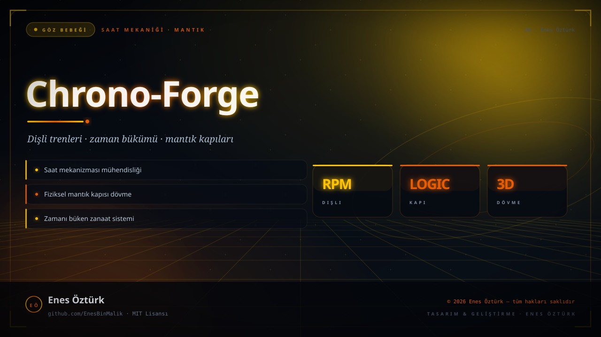
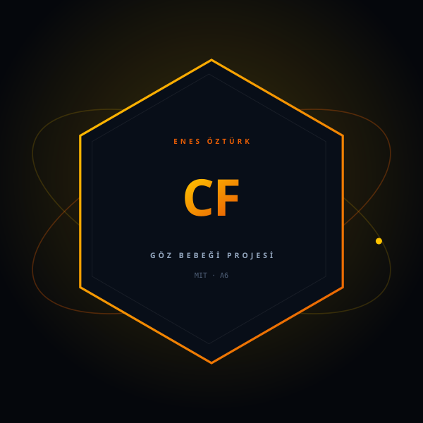

<div align="center">





# Chrono-Forge: The Artisan's Code

**Zamanı dişlilerle döv. Her mantık kapısı bir zanaat, her dişli bir saniye.**

[](https://github.com/EnesBinMalik)
[](LICENSE)
[](https://github.com/EnesBinMalik)

<sub>SAAT MEKANİĞİ · MANTIK KAPILARI · 3D ZANAAT</sub>

</div>

---

## Bu proje nedir?

Zamanı dişlilerle döv. Her mantık kapısı bir zanaat, her dişli bir saniye.

**GÖZ BEBEĞİ** etiketiyle yayınlanmıştır: tasarımı, mimarîsi ve her satırı **Enes Öztürk** tarafından yazılmıştır.

## Öne çıkanlar

- **Saat mekanizması mühendisliği** — dişli trenleri, tork ve gecikme gerçek fizikle hesaplanır.
- **Fiziksel mantık kapıları** — AND/OR/NOT artık kâğıtta değil, dövülen pirinç parçalar.
- **Zaman bükümü** — mekanizmanın hızını değiştirmek, dünyanın hızını değiştirmektir.
- **Zanaat sistemi** — parçaları elle şekillendirip montajla; kusursuz mekanizma kusursuz sonuç verir.

## Teknoloji

`Three.js` · `TypeScript` · `Rapier physics` · `Vite` · `Gear-train simulation` · `Logic gates`

## Kurulum

```bash
npm install
npm run dev
```

## Lisans

**MIT Lisansı** — bkz. [LICENSE](LICENSE)

---

<div align="center">
<sub>© 2026 Enes Öztürk — tüm hakları saklıdır · <a href="https://github.com/EnesBinMalik">Dişliyi mantığa çevir · github.com/EnesBinMalik</a></sub>
</div>
